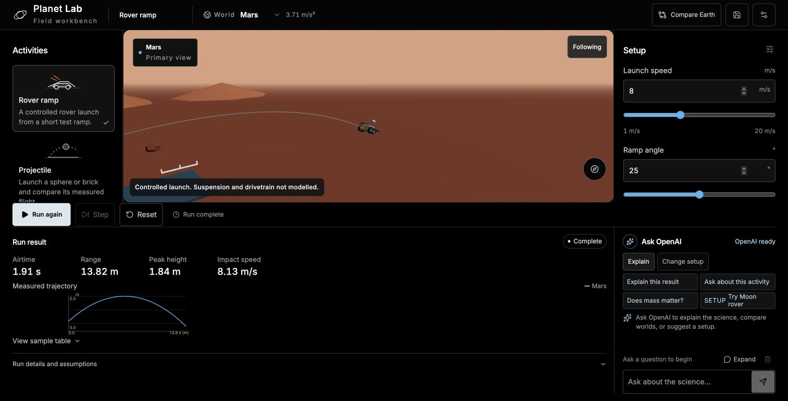
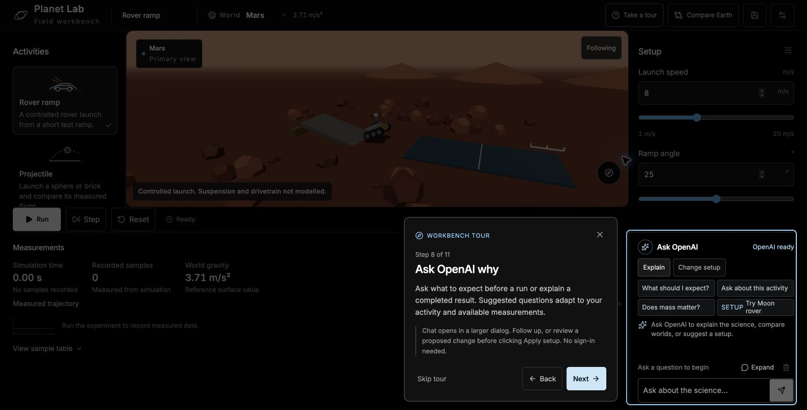
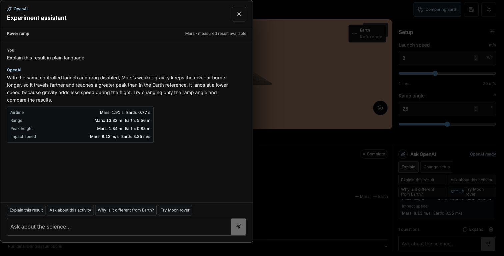
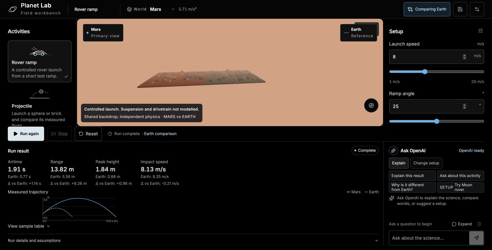

# Planet Lab

### Same experiment. Different world.

A physics workbench with an OpenAI science coach. Launch a rover on Mars, repeat the same experiment on Earth, and ask why the measured results changed. Explore the science through experiments you can see, adjust and repeat.

[**Open the live lab**](https://planet-lab-drab.vercel.app) · [Watch the 66-second demo](https://planet-lab-drab.vercel.app/demo.mp4) · [Demo script](docs/demo-script.md) · [Physics audit](docs/physics-audit.md) · [Assistant evaluations](docs/assistant-evaluation.md)

**No sign-in required.** Ask uses the server's OpenAI key directly. The simulator also works without credentials; Supabase is optional for saving recipes.



New here? Follow the first-visit feature tour, or choose **Take a tour** to replay it. The tour points out controls without changing your experiment.



## Ask, experiment, understand

OpenAI is part of the experiment loop:

1. **Before a run:** explain what the current setup should demonstrate.
2. **After a run:** connect the result to gravity, atmosphere and the model's assumptions.
3. **Compare worlds:** explain matching measurements while holding the recipe constant.
4. **Try an idea:** propose a supported setup change, review its exact parameters, then click **Apply setup**.
5. **Keep asking:** follow up in the expanded conversation. Changing the recipe starts fresh context.



Suggested questions change with the activity and available measurements. The UI includes tested prompts such as **Explain this result**, **Why is it different from Earth?**, **Try air resistance**, **Try a longer string** and **Try no rebound**.

## Six worlds. Six experiments.

Explore Earth, Moon, Mars, Mercury, Venus and Titan. Titan is Saturn's moon; Earth's Moon is included too.

| Experiment | Change | Inspect |
| --- | --- | --- |
| Rover ramp | Launch speed, ramp angle, world | Airtime, range, peak height, impact speed |
| Projectile | Shape, mass, angle, speed, height, drag | Flight path and landing measurements |
| Pendulum | Length, bob mass, release angle | Measured swing period |
| Wind tunnel | Shape, airflow speed, area, atmosphere | Calculated reference drag and dynamic pressure |
| Free fall | Height, mass, drag, world | Fall time and impact speed |
| Bounce | Height, mass, restitution, world | First rebound height and retained energy |



Earth comparison uses identical activity, seed and parameters. Each world runs its own physics state. Changing an input clears stale results; a timeout never invents an impact measurement. Recipes recover locally after refresh and can optionally be saved to Supabase.

## OpenAI integration

The server calls the **Responses API**, using **GPT-6 Luna** by default and **Structured Outputs** generated from shared Zod schemas. The assistant receives the current recipe, world constants, activity assumptions, available run summaries and up to six prior conversation messages. Responses are not canned.

The model returns either an explanation, a validated command proposal, a clarification or an unsupported request. It does not execute generated code. The browser runs the physics and applies reviewed commands through the same controls as manual changes.

Explanations reference available metric IDs. Numeric readouts come from the request's measurement snapshot, including a matched Earth run when present. The server rejects stale recipe bindings, unavailable metric references and numeric explanation prose. These checks constrain the answer; they do not prove every scientific sentence correct. Live evaluations caught an incorrect fall-time comparison and an inaccurate decimal command, which informed the final prompts and selected UI questions. See the [evaluation report](docs/assistant-evaluation.md) and [recorded responses](docs/evals/assistant-results.json).

## Run locally

Use **Node.js 22** and **pnpm 10.34.9**.

```sh
pnpm install --frozen-lockfile
cp .env.example .env.local
pnpm dev
```

Open [localhost:3000](http://localhost:3000). For Ask, add `OPENAI_API_KEY` to `.env.local`; `OPENAI_MODEL` is optional. No Supabase values, account or guest session are required for chat. Keep the OpenAI key server-side.

For cloud saves, configure the three Supabase variables, apply all files in `supabase/migrations/` in filename order, and enable anonymous sign-ins. Saving creates a guest identity silently; there is no login form. Owner-only database policies keep saved recipes separate. See [backend setup](docs/backend-setup.md). Never commit `.env.local`.

## Verify it

```sh
pnpm lint
pnpm typecheck
pnpm test
pnpm build
pnpm test:e2e
```

The browser suite exercises actual Rapier physics, comparisons, mobile controls, follow-up chat, reviewed setup commands and stale-response cancellation. Reference tests compare flight, pendulum, drag and rebound behavior with independent equations.

```sh
pnpm test:ai
```

This opt-in suite makes real, billed OpenAI calls and writes an evaluation report. The complete suite also checks Supabase save isolation and database quota primitives, so it requires the optional Supabase configuration. It is separate from normal tests.

## Model boundaries

Planet Lab is built for learning and controlled comparisons. It uses fixed near-surface gravity and atmosphere, simplified collision shapes, and constant drag coefficients. It has no CFD, buoyancy, heat transfer or material-survival model. Rover suspension, tire grip and drivetrain are omitted. Wind streaks illustrate flow; wind-tunnel results are calculated reference values.

The [physics audit](docs/physics-audit.md) records equations, tolerances and solver limits. The [world reference catalog](docs/world-reference-states.md) links the scientific sources.

## Built at the OpenAI hackathon

Codex coordinated smaller GPT-6 Luna agents across backend, physics, interface and documentation work, then integrated and verified the results. Shared contracts let agents work in separate lanes. The scientific audit and browser tests checked the resulting implementation rather than treating generated code as proof.

**Stack:** Next.js · React · TypeScript · Three.js / React Three Fiber · Rapier · Zustand · Zod · OpenAI Responses API · Supabase · Vercel.

Procedural assets are authored in this repository and listed in [asset credits](public/assets/credits.json).

- [Demo script](docs/demo-script.md) — the judge-facing story in 90 seconds.
- [Verification record](docs/verification.md) — checks, evidence and known limits.
- [Build plan](PLAN.md), [design](DESIGN.md), [contracts](docs/planet-lab-contracts.md) — implementation context.
- [Hackathon brief](HACKATHON.md) — event and judging criteria.
